<p align="center">
  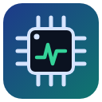
</p>

<h1 align="center">Embedded Studio</h1>

<p align="center">
  <b>STM32 için görsel gömülü sistem tasarımı, VS Code içinde.</b><br>
  Sensörleri seç · pinleri ve saati otomatik ata · HAL / bare-metal + FreeRTOS kodu üret · derle, yükle, canlı izle, debug et.
</p>

<p align="center">
  <a href="https://marketplace.visualstudio.com/items?itemName=mhmtakfseckin.embedded-studio"></a>
  <a href="https://marketplace.visualstudio.com/items?itemName=mhmtakfseckin.embedded-studio"></a>
  <a href="https://github.com/k4zmo55/Embedded-Studio/actions/workflows/test.yml"></a>
  <a href="LICENSE"></a>
  
</p>

<p align="center">
  <a href="#-kurulum">Kurulum</a> ·
  <a href="#-hızlı-başlangıç">Hızlı başlangıç</a> ·
  <a href="#-özellikler">Özellikler</a> ·
  <a href="#-katkı">Katkı</a> ·
  <a href="#english">English</a>
</p>

<p align="center">
  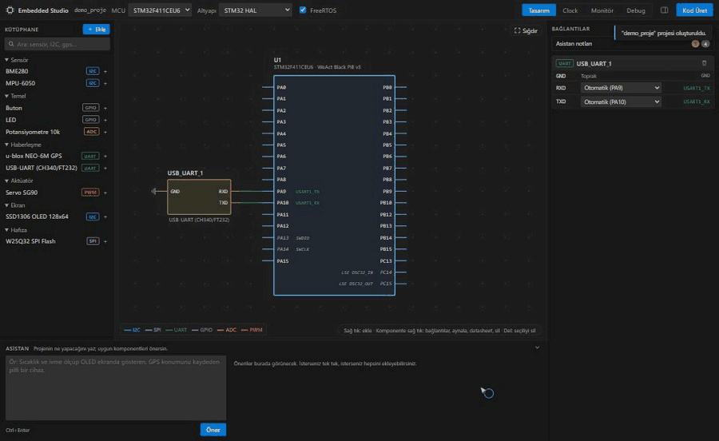
</p>

## Neden Embedded Studio?

Bir sensörü mikrodenetleyiciye bağlamak çoğu zaman şu adımlarla geçer: datasheet'ten alternatif fonksiyon tablosuna bakmak,
çakışan pinleri ayıklamak, saat ağacını hesaplamak, init kodunu yazmak, sonra da her şeyin gerçekten çalıştığını görmek için
seri port çıktısıyla uğraşmak. Embedded Studio bu döngüyü tek bir yerde topluyor:

- 🧩 **Komponenti seç, gerisini o ayarlasın.** I2C/SPI/UART/ADC/PWM atamaları, alternatif fonksiyonlar ve I2C adres çakışmaları otomatik çözülür.
- ⏱️ **CubeMX tarzı saat ağacı.** Hedef frekansı yaz, geçerli PLL ayarını o bulsun; sınır aşımları kırmızıyla gösterilir.
- 🛠️ **Derlenen kod.** STM32 HAL ya da doğrudan register, isteğe bağlı FreeRTOS. CMake + ARM GCC projesi hazır gelir.
- ✍️ **Kodun asla ezilmez.** `USER CODE` blokları korunur; tasarım değişince sadece etkilenen dosyalar güncellenir.
- 🤖 **Yapay zekâ ajanlarıyla uyumlu.** Claude, ChatGPT/Codex, Gemini ve Copilot için hazır `AGENTS.md` / `CLAUDE.md` / `GEMINI.md`.
- 📈 **Canlı monitör ve debug.** 3B IMU, GPS rotası, göstergeler, RTOS task tablosu; register'lar, bellek ve değişkenler.

## 📦 Kurulum

<p align="center">
  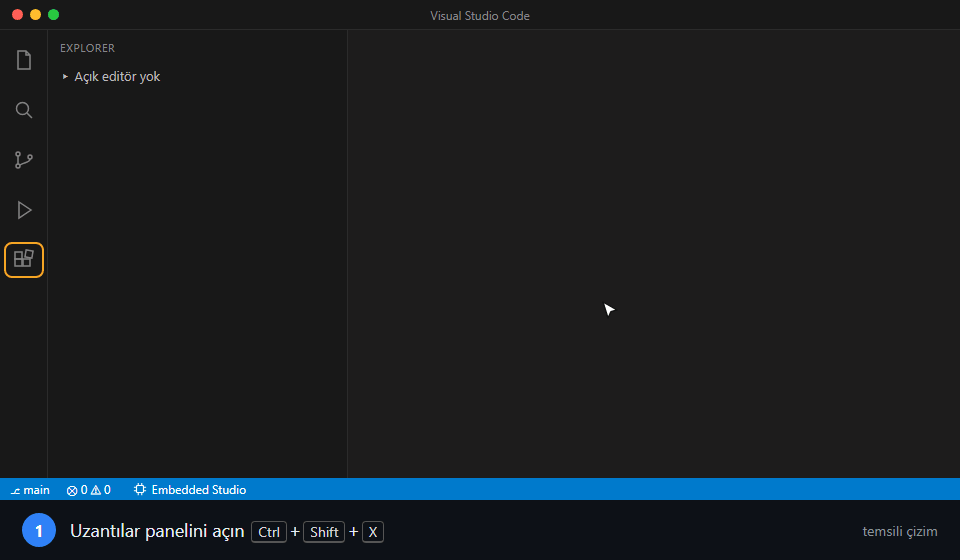
  <br><sub>Kurulum adımları (temsili çizim). Son karedeki sihirbaz eklentinin gerçek ekranıdır.</sub>
</p>

<table>
  <tr>
    <td width="50%">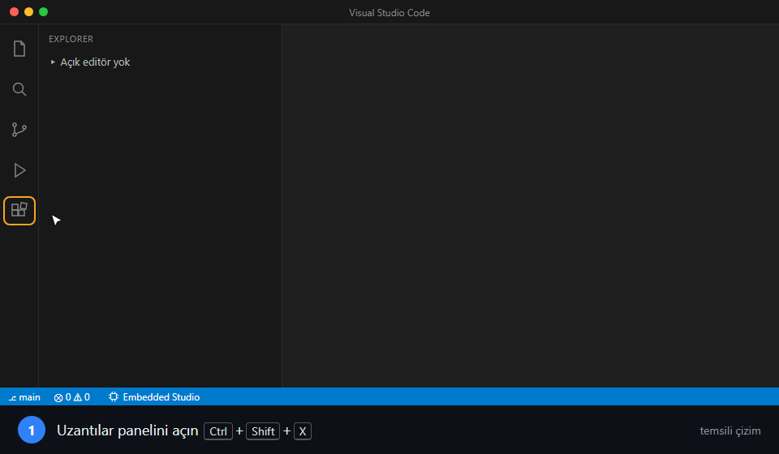<br><b>1.</b> VS Code'da <b>Uzantılar</b> panelini açın (<kbd>Ctrl</kbd>+<kbd>Shift</kbd>+<kbd>X</kbd>).</td>
    <td width="50%">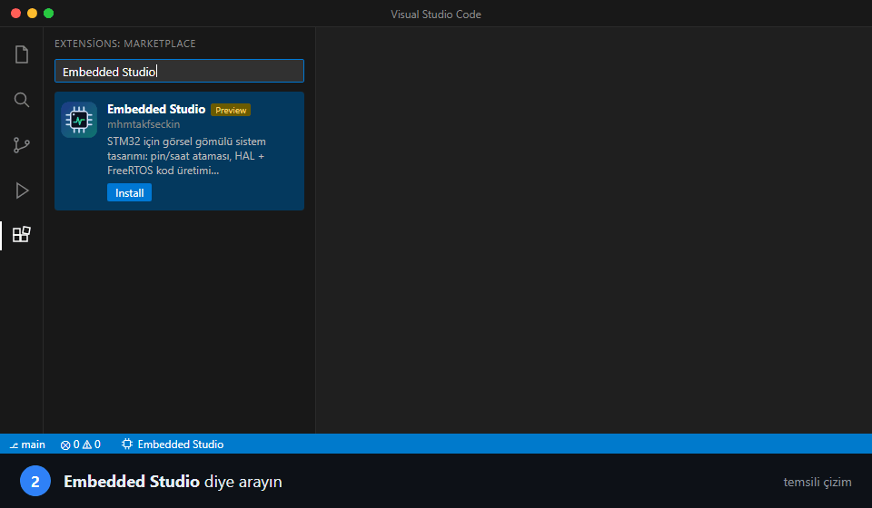<br><b>2.</b> Arama kutusuna <b>Embedded Studio</b> yazın.</td>
  </tr>
  <tr>
    <td>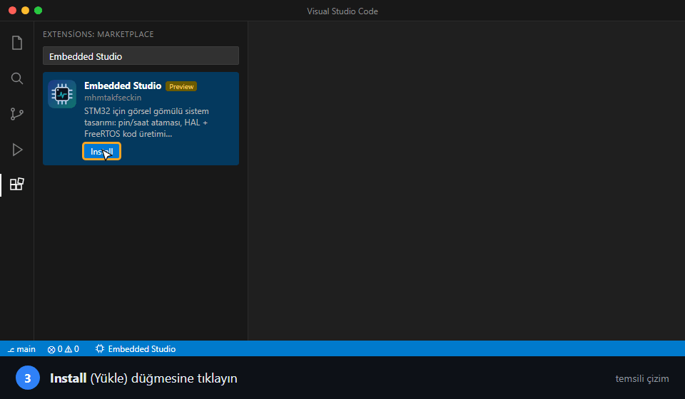<br><b>3.</b> <b>Install</b> (Yükle) düğmesine tıklayın.</td>
    <td>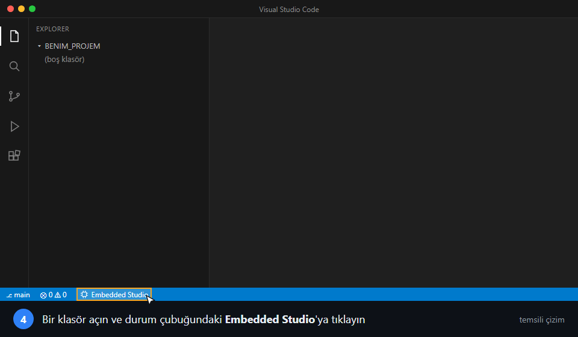<br><b>4.</b> Bir klasör açın, alttaki durum çubuğunda <b>Embedded Studio</b>'ya tıklayın.</td>
  </tr>
</table>

**Diğer yollar**

- Tarayıcıdan: [Marketplace sayfasında](https://marketplace.visualstudio.com/items?itemName=mhmtakfseckin.embedded-studio) **Install**'a tıklayın.
- Komut satırından: `code --install-extension mhmtakfseckin.embedded-studio`
- Kaynaktan: repoyu klonlayıp `node tools/package-vsix.js` ile `.vsix` üretin, VS Code'da
  `Ctrl+Shift+P` → **Extensions: Install from VSIX…** ile kurun.

### Gereksinimler

Tasarım ve kod üretimi için hiçbir şey gerekmez. Derleme, karta yükleme ve kütüphane indirme için şunlar `PATH`'te olmalı:

| Araç | Ne için | Nereden |
|---|---|---|
| `git` | HAL / CMSIS / FreeRTOS kaynaklarını indirmek | [git-scm.com](https://git-scm.com) |
| `cmake` + `ninja` | Derleme | [cmake.org](https://cmake.org) · [ninja-build.org](https://ninja-build.org) |
| `arm-none-eabi-gcc` | ARM derleyicisi | [Arm GNU Toolchain](https://developer.arm.com/downloads/-/arm-gnu-toolchain-downloads) |
| `openocd` + ST-Link sürücüsü | Karta yükleme ve gerçek kartla debug | [xPack OpenOCD](https://xpack-dev-tools.github.io/openocd-xpack/) |

## 🚀 Hızlı başlangıç

1. Boş bir klasör açın ve durum çubuğundaki **Embedded Studio**'ya tıklayın.
2. Sihirbazda proje adını, mikrodenetleyiciyi, **STM32 HAL / bare-metal** ve **FreeRTOS** seçimini yapın.
3. Soldaki kütüphaneden komponent ekleyin ya da alttaki asistana ne yapmak istediğinizi yazın:
   *"Sıcaklık ve ivme ölçüp OLED ekranda gösteren bir cihaz"*.
4. **Kod Üret** → <kbd>Ctrl</kbd>+<kbd>Shift</kbd>+<kbd>B</kbd> ile derleyin → Debug sekmesinden **Yükle**.
5. **Monitör** sekmesinde verileri canlı izleyin.

<p align="center">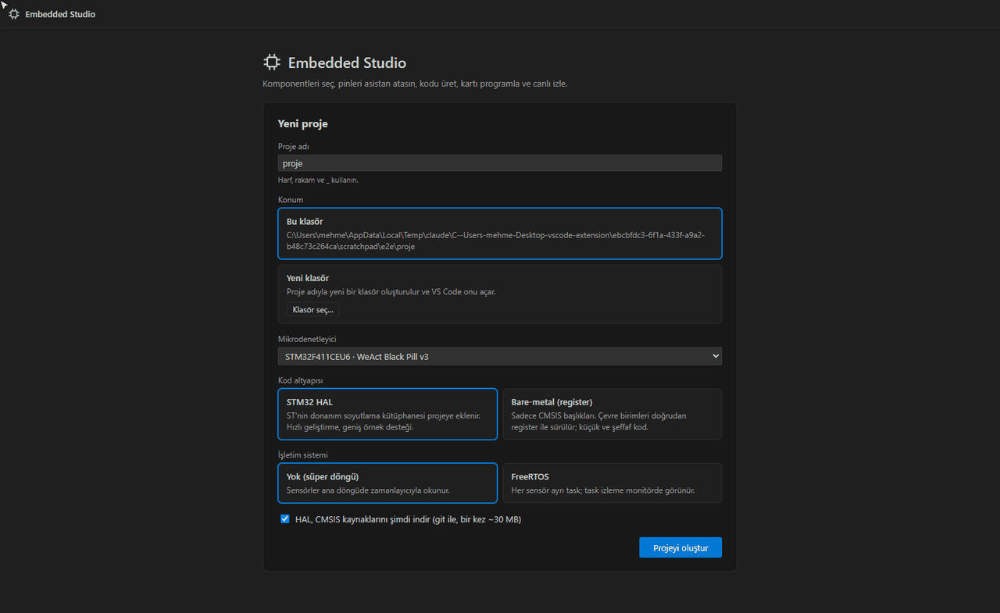</p>

## ✨ Özellikler

### Tasarım: KiCad tarzı şema

Komponentler mikrodenetleyiciye otomatik bağlanır, kablolar sinyal türüne göre renklenir. Bir pini elle seçerseniz geri kalan
atama ona göre yeniden çözülür. Her değişiklik otomatik kaydedilir.

| Sağ tık menüsü | Bağlantılar penceresi |
|---|---|
| 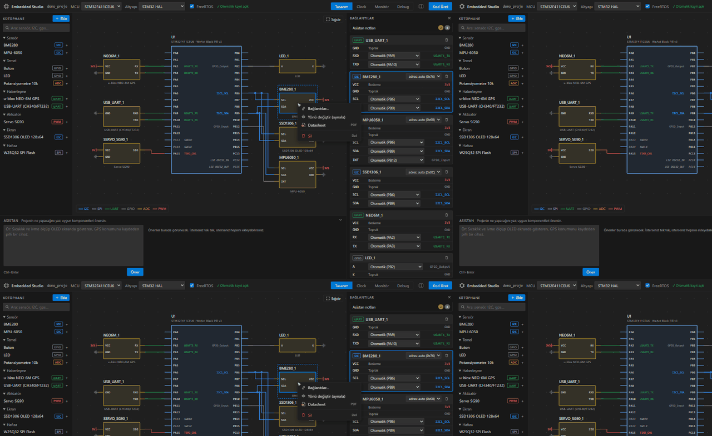 | 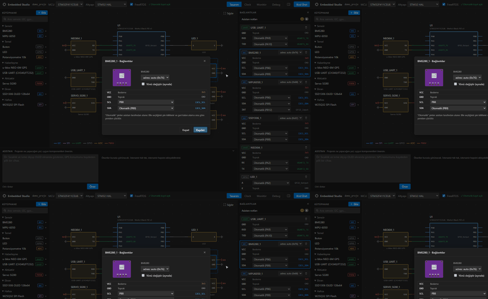 |
| **Bağlantılar**, **Yönü değiştir (aynala)**, **Datasheet** (PDF indirir), **Sil**. <kbd>Del</kbd> / <kbd>Backspace</kbd> de çalışır. | Pinleri seçip **Kaydet**; **Kapat** değişiklikleri atar. I2C adresi de buradan seçilir. |

Komponentin üzerine gelince resimli bir bilgi kartı açılır. Alt paneldeki asistan, yazdığınız isteğe göre komponent önerir.

### Komponent oluşturucu

Kütüphanede olmayan bir sensörü JSON yazmadan ekleyin. Form solda, canlı şema sembolü, bilgi kartı ve doğrulama sağda.

<p align="center">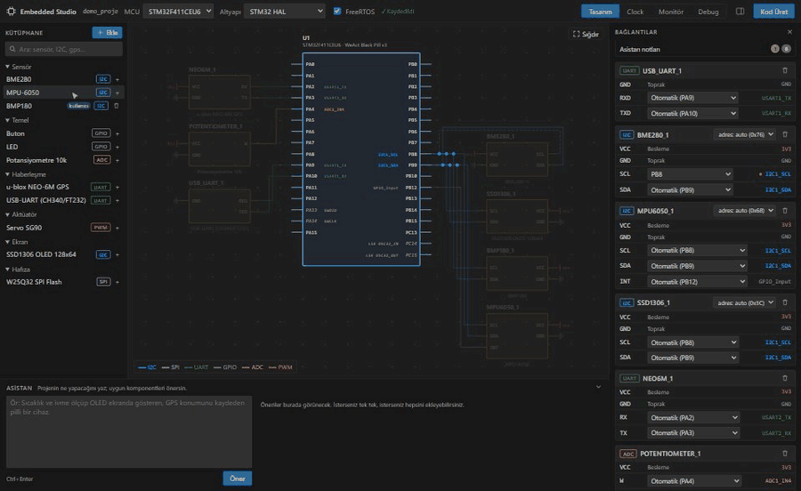</p>

### Clock: saat ağacı

<p align="center">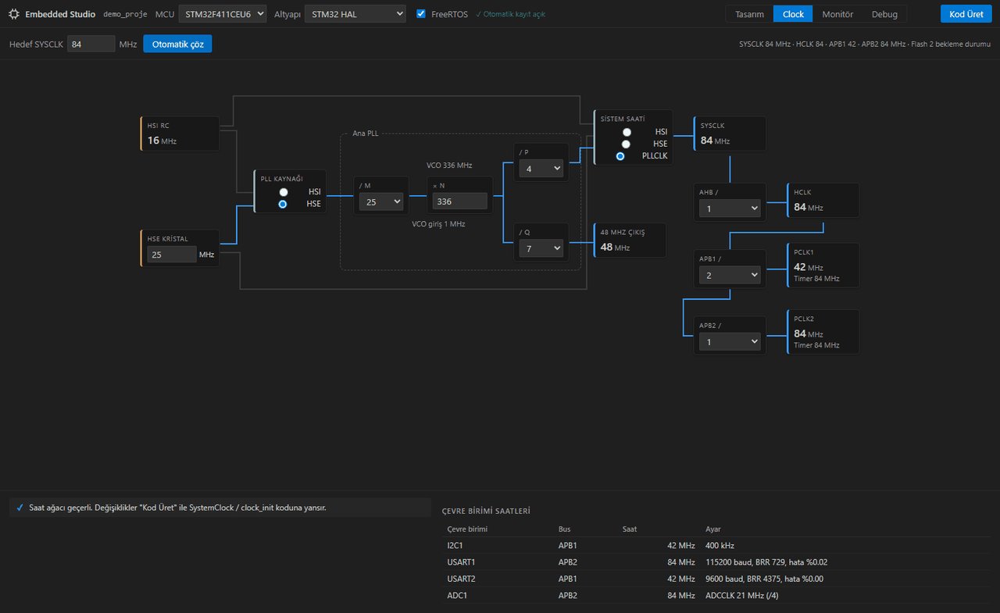</p>

HSI/HSE, PLL (M/N/P/Q), AHB/APB bölücüleri. **Otomatik çöz** hedef frekans için geçerli ayarı bulur; çevre birimi tablosu UART
baud hatasını, SPI hızını ve timer ön bölücüsünü gösterir. Ayarlar üretilen `SystemClock_Config` / `clock_init` koduna yansır.

### Kod üretimi

```
Core/Src/app.c          ← sizin kodunuz USER CODE bloklarında
Core/Src/board.c        ← saat, GPIO, I2C/SPI/UART/ADC/TIM init (HAL veya register)
Core/Src/bsp.c          ← sürücülerin kullandığı ortak donanım API'si
Drivers/Components/     ← sensör sürücüleri (BME280, MPU-6050, NMEA...)
CMakeLists.txt          ← arm-none-eabi-gcc + Ninja
AGENTS.md, CLAUDE.md    ← yapay zekâ ajanları için proje kuralları
.embedded-studio/LAST_CHANGES.md ← son tasarım değişikliği
```

- Tasarım değişmediyse **hiçbir dosyaya dokunulmaz**.
- Bir sensörü çıkarırsanız sürücüsü kaldırılır ama **ona yazdığınız kod silinmez**; dosyanın sonunda `#if 0` bloğunda durur.
- Üretilen kod her push'ta Linux'ta **ARM GCC ile dört varyantta** (HAL / register × RTOS / RTOS'suz) `-Wall -Wextra` altında derlenir.

### Monitör

<p align="center">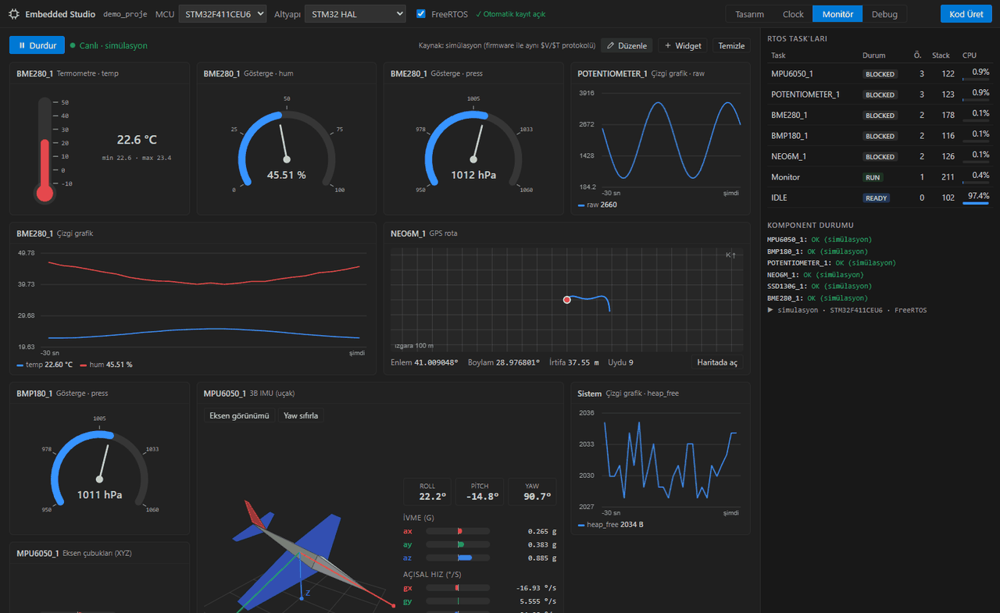</p>

Her sensör için uygun görünüm: **3B IMU** (uçak modeli ve kırmızı/yeşil/mavi eksenler), GPS rotası, termometre, gösterge, lamba
ve grafik. Widget'ların türünü ve boyutunu değiştirin, sürükleyip sıralayın. FreeRTOS task'larının durumu, boş stack'i ve CPU payı
sağdaki tabloda.

### Debug

<p align="center">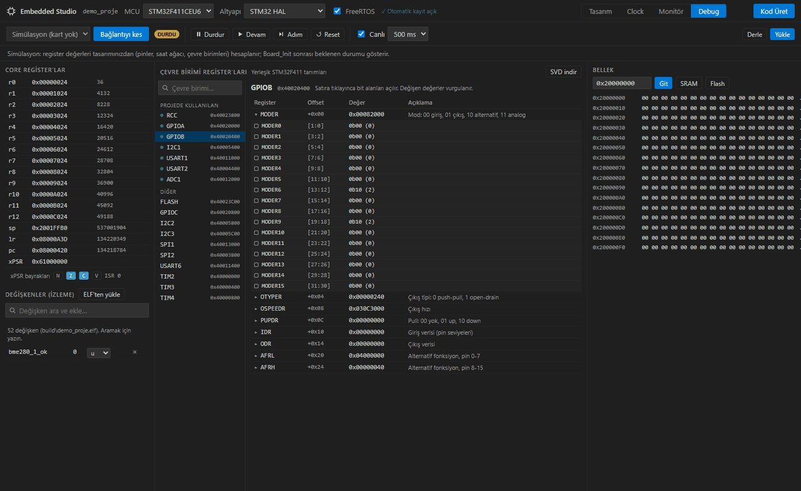</p>

Simülasyon ya da **OpenOCD + ST-Link**: durdur, devam, adım, reset; core register'lar ve xPSR bayrakları; bit alanlarıyla
çevre birimi register'ları (yerleşik tanımlar ya da tam CMSIS-SVD); bellek görüntüleyici; ELF'ten değişken izleme.
Okuması bayrak temizleyen register'lar (ör. `USART->DR`) sadece hedef durduğunda okunur; çalışan firmware'den veri çalınmaz.

## 🔌 Desteklenenler

| | |
|---|---|
| **Mikrodenetleyici** | STM32F411CEU6 (WeAct Black Pill). Diğer STM32F4'ler bir JSON dosyasıyla eklenebilir. |
| **Komponentler** | BME280, MPU-6050, SSD1306 OLED, W25Q32 SPI flash, u-blox NEO-6M GPS, USB-UART, LED, buton, potansiyometre, SG90 servo |
| **Kod altyapısı** | STM32 HAL · bare-metal (CMSIS register) · isteğe bağlı FreeRTOS |
| **Programlayıcı** | ST-Link (OpenOCD) |

## 🗺️ Yol haritası

- [x] Pin ve saat ataması, HAL / bare-metal + FreeRTOS kod üretimi
- [x] Monitör, debug, komponent oluşturucu
- [ ] Monitörde seri port üzerinden gerçek kart verisi
- [ ] Yeni MCU'lar: STM32F4 ailesinin geri kalanı, STM32G4/L4, ESP32, RP2040
- [ ] LLM destekli asistan ve datasheet'ten komponent taslağı çıkarma
- [ ] İngilizce arayüz

Fikriniz mi var? [Özellik isteği açın](https://github.com/k4zmo55/Embedded-Studio/issues/new?template=feature_request.yml).

## 🤝 Katkı

Katkılarınızı bekliyoruz. Kod yazmanız gerekmiyor; en değerli katkılardan bazıları kod dışı:

| Ne yapabilirsiniz | Nasıl |
|---|---|
| 🐞 Hata bildirin | [Hata bildirimi](https://github.com/k4zmo55/Embedded-Studio/issues/new?template=bug_report.yml) |
| 🔌 Kartınızda deneyin | Özellikle ST-Link ile yükleme ve debug. Sonucu bir issue'da paylaşın. |
| 🧩 **Komponent ekleyin** | Komponent oluşturucuyla tanımlayın → **Dışa aktar** → `data/components/` altına PR açın |
| 📝 Dokümantasyon / çeviri | README, rehberler, İngilizce arayüz metinleri |
| 💻 Kod | Sürücüler, yeni MCU'lar, monitör widget'ları, seri port kaynağı |

Geliştirme ortamı, proje yapısı, kod kuralları ve PR süreci için **[CONTRIBUTING.md](CONTRIBUTING.md)**'ye bakın.

Planlanan işler ve öncelikler **[ROADMAP.md](ROADMAP.md)** dosyasında; her madde bir [GitHub issue](https://github.com/k4zmo55/Embedded-Studio/issues) olarak da açık. Üzerinde çalışmak istediğiniz issue'ya yorum bırakmanız yeterli.
İlk katkı için [`good first issue`](https://github.com/k4zmo55/Embedded-Studio/labels/good%20first%20issue) etiketli issue'lar uygun.

```bash
git clone https://github.com/k4zmo55/Embedded-Studio.git
cd Embedded-Studio && code .   # F5 ile eklentiyi çalıştırın, derleme adımı yok
node test/smoke.js             # birim testleri
```

## English

<details>
<summary><b>Embedded Studio in English</b></summary>

Embedded Studio is a VS Code extension for visually designing STM32 firmware. Pick the sensors you need and it wires them to
the microcontroller in a KiCad-style schematic, assigns pins and peripherals (alternate functions, conflicts, I2C address
clashes), builds a valid clock tree, and generates a CMake + ARM GCC project using **STM32 HAL** or **bare-metal register**
code, optionally with **FreeRTOS**. Your code inside `USER CODE` blocks is preserved across regenerations, and generated
`AGENTS.md` / `CLAUDE.md` / `GEMINI.md` files tell AI coding agents which files they may edit.

It also includes a live monitor (3D IMU, GPS track, gauges, RTOS task table), a debugger front-end for OpenOCD + ST-Link
(peripheral registers with bit fields, memory, variable watch) and a component creator for adding your own sensors.

The UI is currently in Turkish; an English UI is on the roadmap. Contributions are welcome, see
[CONTRIBUTING.md](CONTRIBUTING.md) (in Turkish; feel free to open issues in English).

</details>

## Lisans

[MIT](LICENSE) © Mehmet Akif Seçkin
